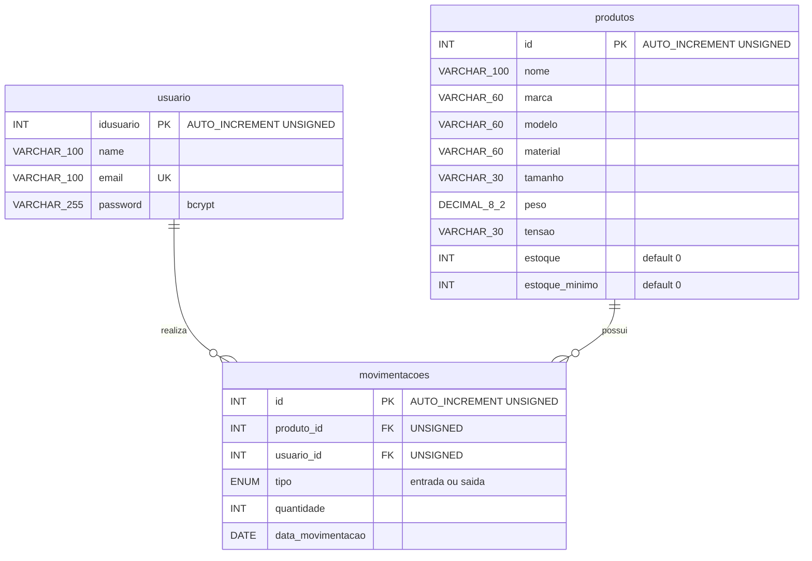

# Entrega 02 - Diagrama entidade relacionamento

Todas as colunas são NOT NULL. `usuario` guarda usuários autenticados; e-mail é único e senha é bcrypt. `produtos` descreve ferramentas, saldo atual e mínimo; peso é em kg. `movimentacoes` registra quantidade, tipo, data e responsável, sem timestamps. Cada movimento pertence obrigatoriamente a um usuário e um produto; cada um pode ter zero ou muitos movimentos. FKs usam ON DELETE RESTRICT e ON UPDATE CASCADE. INT UNSIGNED é usado para PKs e FKs compatíveis; continua sendo INT de 32 bits, não BIGINT. O PNG acompanha este diagrama.
